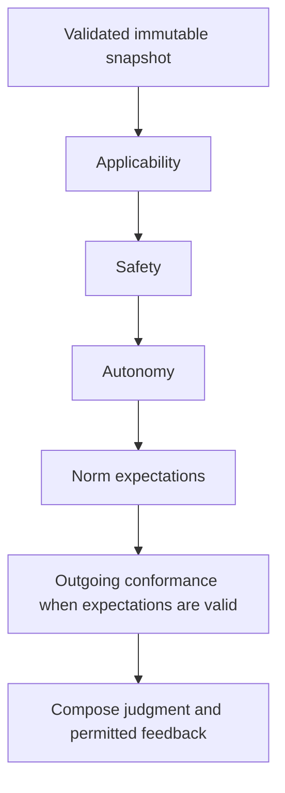

# client/policy

_`packages/client/src/policy`_

## Purpose

Service-composition boundary for data-only message assessment.

## Public surface

### [`makeJevDecisionProvider`](https://github.com/chughtapan/moltzap/blob/main/packages/client/src/policy/jev.ts#L169)

_Function_

```ts
export function makeJevDecisionProvider(options: {
  readonly apiKey: Redacted.Redacted;
  readonly model: string;
}): PolicyDecisionProvider
```

Uses the fixed TypeSafe origin and an explicitly pinned model. No retry,
environment lookup or credential serialization occurs here. The evaluator
owns timeouts; the Effect is interruptible through response-body consumption.

### [`makeMessagePolicyEvaluator`](https://github.com/chughtapan/moltzap/blob/main/packages/client/src/policy/evaluator.ts#L264)

_Variable_

```ts
export const makeMessagePolicyEvaluator = Effect.fn(
  "makeMessagePolicyEvaluator",
)(function* (options: {
  readonly provider: PolicyDecisionProvider;
  readonly settings: unknown;
}): Effect.fn.Return<MessagePolicyEvaluator, MessagePolicyInputError> {
  const settings = yield* Schema.decodeUnknown(MessagePolicySettings)(
    options.settings,
  ).pipe(
    Effect.catchTag("ParseError", () =>
      Effect.fail(new MessagePolicyInputError({ reason: "settings" })),
    ),
  );
  const frozenSettings = Object.freeze(new MessagePolicySettings(settings));
  const provider = Object.freeze({
    decide: options.provider.decide.bind(options.provider),
  });
  return {
    evaluate: (input) => evaluateSnapshot(input, provider, frozenSettings),
  };
})
```

Builds the same value-oriented evaluator for offline and live composition.
Interruption propagates normally. A semantic rejection does not skip later
independent diagnostics; missing expectations make conformance unavailable.



### [`MessagePolicyAssessment`](https://github.com/chughtapan/moltzap/blob/main/packages/client/src/policy/values.ts#L198)

_Interface_

```ts
export interface MessagePolicyAssessment {
  readonly binding: string;
  readonly questionEdition: string;
  readonly policyDigest: string;
  readonly settings: MessagePolicySettings;
  readonly judgment: "allow" | "block" | "hold" | "revise";
  readonly reason:
    | "eligible"
    | "prohibited"
    | "unresolved-evidence"
    | "assessment-unavailable"
    | "norm-violation"
    | "approval-required";
  readonly feedback: ReadonlyArray<{
    readonly nextAction: typeof nextAction.Type;
    readonly text: string;
  }>;
  readonly guidance: readonly PolicyNormGuidance[];
  readonly trace: readonly PolicyStageTrace[];
}
```

The judgment is not an admission receipt. Client must still fence the binding
atomically with delivery or intent publication. Guidance is absent on refusals.

### [`MessagePolicyEvaluator`](https://github.com/chughtapan/moltzap/blob/main/packages/client/src/policy/values.ts#L220)

_Interface_

```ts
export interface MessagePolicyEvaluator {
  readonly evaluate: (
    snapshot: unknown,
  ) => Effect.Effect<MessagePolicyAssessment, MessagePolicyInputError>;
}
```

Pure assessment with typed composition errors and normal Effect cancellation.

### [`MessagePolicyInputError`](https://github.com/chughtapan/moltzap/blob/main/packages/client/src/policy/values.ts#L156)

_Class_

```ts
export class MessagePolicyInputError extends Data.TaggedError(
  "MessagePolicyInputError",
)<{
  readonly reason: "settings" | "snapshot";
}> {}
```

Invalid composition input never reaches inference or becomes permission.

### [`MessagePolicySettings`](https://github.com/chughtapan/moltzap/blob/main/packages/client/src/policy/values.ts#L73)

_Class_

```ts
export class MessagePolicySettings extends Schema.Class<MessagePolicySettings>(
  "MessagePolicySettings",
)({
  minimumProbability: Schema.Number.pipe(Schema.between(0.5, 1)),
  maximumRequestBytes: Schema.Positive.pipe(Schema.int()),
  timeoutMilliseconds: Schema.Positive.pipe(Schema.int()),
}) {}
```

Byte budgets bound serialized input without estimating tokenizer output.
A selected probability is a routing threshold, not provider confidence or
a claimed safety guarantee. Every stage uses this same recorded setting.

### [`MessagePolicySnapshot`](https://github.com/chughtapan/moltzap/blob/main/packages/client/src/policy/values.ts#L32)

_Class_

```ts
export class MessagePolicySnapshot extends Schema.Class<MessagePolicySnapshot>(
  "MessagePolicySnapshot",
)({
  binding: identifier,
  principal: identifier,
  direction: Schema.Literal("incoming", "outgoing"),
  candidate: message,
  policy: Schema.Struct({
    digest: identifier,
    rules: Schema.NonEmptyArray(rule),
  }),
  history: Schema.Array(
    message.pipe(
      Schema.extend(
        Schema.Struct({
          visibility,
          admission: Schema.Literal("admitted", "withheld"),
        }),
      ),
    ),
  ),
  facts: Schema.Array(
    Schema.Struct({
      id: identifier,
      source: identifier,
      text: Schema.NonEmptyString,
      visibility,
    }),
  ),
  gaps: Schema.Array(Schema.NonEmptyString),
  authorization: Schema.Union(
    Schema.Struct({ kind: Schema.Literal("absent") }),
    Schema.Struct({ kind: Schema.Literal("verified"), binding: identifier }),
  ),
}) {}
```

Trusted composition supplies authenticated attribution, authorized evidence
and an opaque binding of the exact candidate, owner, recipients and versions.
Verified authorization is an upstream capability, never a peer claim. Only
explicitly publishable rule guidance/feedback and safe evaluator-owned
fallback feedback may reach the runtime.

### [`PolicyDecisionProvider`](https://github.com/chughtapan/moltzap/blob/main/packages/client/src/policy/values.ts#L149)

_Interface_

```ts
export interface PolicyDecisionProvider {
  readonly decide: (
    request: PolicyDecisionRequest,
  ) => Effect.Effect<PolicyDecisionResponse, PolicyProviderFailure>;
}
```

A provider cannot send, approve, activate policy or query additional facts.

### [`PolicyDecisionRequest`](https://github.com/chughtapan/moltzap/blob/main/packages/client/src/policy/values.ts#L94)

_Interface_

```ts
export interface PolicyDecisionRequest {
  readonly stage: PolicyStage;
  readonly state: string;
  readonly questions: Readonly<
    Record<
      string,
      {
        readonly ruleId: string;
        readonly purpose: "assessment" | "subject";
        readonly subject?: string;
        readonly instructions: string;
        readonly criteria: Readonly<Record<string, string>>;
      }
    >
  >;
}
```

State is serialized JSON. Question ids and purpose are audit metadata;
instructions carry rule identity because providers need not expose ids to
the underlying model.

### [`PolicyDecisionResponse`](https://github.com/chughtapan/moltzap/blob/main/packages/client/src/policy/values.ts#L112)

_Class_

```ts
export class PolicyDecisionResponse extends Schema.Class<PolicyDecisionResponse>(
  "PolicyDecisionResponse",
)({
  provider: identifier,
  model: identifier,
  answers: Schema.Record({
    key: identifier,
    value: Schema.Struct({
      choice: identifier,
      probabilities: Schema.Record({ key: identifier, value: probability }),
      confidence: Schema.optional(probability),
    }),
  }),
  usage: Schema.Record({ key: identifier, value: Schema.NonNegativeInt }),
  raw: Schema.String,
}) {}
```

Raw distributions and provider confidence survive routing unchanged.

### [`PolicyNormGuidance`](https://github.com/chughtapan/moltzap/blob/main/packages/client/src/policy/values.ts#L187)

_Interface_

```ts
export interface PolicyNormGuidance {
  readonly ruleId: string;
  readonly expectation: "required" | "permitted" | "wait" | "none";
  readonly subjects: readonly string[];
  readonly instruction?: string;
}
```

References are selected independently from admitted runtime-visible messages.

### [`PolicyProviderFailure`](https://github.com/chughtapan/moltzap/blob/main/packages/client/src/policy/values.ts#L134)

_Class_

```ts
export class PolicyProviderFailure extends Data.TaggedError(
  "PolicyProviderFailure",
)<{
  readonly reason:
    | "configuration"
    | "transport"
    | "http"
    | "timeout"
    | "invalid-response"
    | "budget";
  readonly status?: number;
  readonly response?: string;
}> {}
```

Closed operational reasons are safe to project without provider diagnostics.
The optional response belongs only in the private audit and must be scrubbed
of credentials by the provider adapter.

### [`PolicyStage`](https://github.com/chughtapan/moltzap/blob/main/packages/client/src/policy/values.ts#L82)

_TypeAlias_

```ts
export type PolicyStage =
  | "applicability"
  | "safety"
  | "autonomy"
  | "expectations"
  | "conformance";
```

The fixed chain is versioned independently of policy wording and models.

### [`PolicyStageTrace`](https://github.com/chughtapan/moltzap/blob/main/packages/client/src/policy/values.ts#L167)

_TypeAlias_

```ts
export type PolicyStageTrace = {
  readonly stage: PolicyStage;
  readonly elapsedMilliseconds: number;
} & (
  | {
      readonly status: "answered";
      readonly request: PolicyDecisionRequest;
      readonly response: PolicyDecisionResponse;
      readonly uncertainQuestions: readonly string[];
    }
  | {
      readonly status: "failed";
      readonly request?: PolicyDecisionRequest;
      readonly failure: PolicyProviderFailure;
    }
  | { readonly status: "empty" }
  | { readonly status: "unavailable"; readonly dependency: "expectations" }
);
```

An unavailable dependency is distinct from an answered but uncertain question.
Trace requests, responses and evidence are private assessor material.
A preparation-budget failure has no request; partial requests never escape.

## Files

- `evaluator.ts`
- `jev.ts`
- `values.ts`
