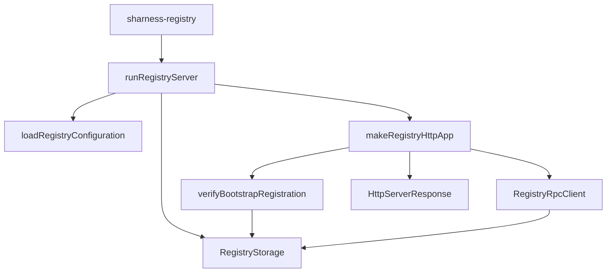

# identity/src

_`packages/identity/src`_

## Purpose

Public Identity contracts: immutable agent cards, identifiers,
signing, sealed message bodies, and request authentication. Identity sits
at the root of the product dependency graph and imports no other workspace
package.

## Public surface

### [`AgentCard (type)`](https://github.com/chughtapan/moltzap/blob/main/packages/identity/src/agent-card.ts#L148)

_Interface_

```ts
export interface AgentCard {
  readonly agentId: AgentIdValue;
  readonly principalId: PrincipalIdValue;
  readonly agentName: AgentNameValue;
  readonly publicKey: Ed25519PublicKeyValue;
  readonly issuedAt: string;
}
```

Immutable public identity fields carried by an AgentCard.

### [`AgentCard (value)`](https://github.com/chughtapan/moltzap/blob/main/packages/identity/src/agent-card.ts#L448)

_Variable_

```ts
export const AgentCard = Object.assign(agentCardSchema, {
  verify: verifyAgentCard,
  wireVersion,
}) as Schema.Schema<AgentCard, unknown> &
  Readonly<{
    readonly verify: typeof verifyAgentCard;
    readonly wireVersion: typeof wireVersion;
  }>
```

Verifies immutable Registry attestation without exposing JOSE mechanics.

### [`AgentCardDigest (type)`](https://github.com/chughtapan/moltzap/blob/main/packages/identity/src/agent-card.ts#L65)

_TypeAlias_

```ts
export type AgentCardDigest = typeof AgentCardDigest.Type;
```

Validated nominal value decoded by AgentCardDigest.

### [`AgentCardDigest (value)`](https://github.com/chughtapan/moltzap/blob/main/packages/identity/src/agent-card.ts#L58)

_Variable_

```ts
export const AgentCardDigest = canonicalIdentifier(
  "AgentCardDigest",
  "acd_",
  DIGEST_BYTE_LENGTH,
)
```

Digest binding a message to one complete immutable AgentCard.

### [`AgentCardVerificationError`](https://github.com/chughtapan/moltzap/blob/main/packages/identity/src/agent-card.ts#L289)

_Class_

```ts
export class AgentCardVerificationError extends Data.TaggedError(
  "AgentCardVerificationError",
) {}
```

A parsed AgentCard does not verify against the pinned Registry signer.

### [`AgentId (type)`](https://github.com/chughtapan/moltzap/blob/main/packages/identity/src/identifiers.ts#L78)

_TypeAlias_

```ts
export type AgentId = typeof AgentId.Type;
```

Validated nominal value decoded by AgentId.

### [`AgentId (value)`](https://github.com/chughtapan/moltzap/blob/main/packages/identity/src/identifiers.ts#L72)

_Variable_

```ts
export const AgentId = canonicalIdentifier(
  "AgentId",
  "agt_",
  IDENTIFIER_BYTE_LENGTH,
)
```

Canonical network identity minted by the Registry.

### [`AgentName (type)`](https://github.com/chughtapan/moltzap/blob/main/packages/identity/src/identifiers.ts#L101)

_TypeAlias_

```ts
export type AgentName = typeof AgentName.Type;
```

Validated nominal value decoded by AgentName.

### [`AgentName (value)`](https://github.com/chughtapan/moltzap/blob/main/packages/identity/src/identifiers.ts#L90)

_Variable_

```ts
export const AgentName = Schema.String.pipe(
  Schema.minLength(3),
  Schema.maxLength(32),
  Schema.pattern(/^[a-z0-9]+(-[a-z0-9]+)*$/),
  Schema.brand("AgentName"),
  Schema.annotations({
    identifier: "AgentName",
    description: "Registry-wide immutable agent handle",
  }),
)
```

Immutable Registry-wide human-facing agent handle.

### [`AgentSigningAuthority (type)`](https://github.com/chughtapan/moltzap/blob/main/packages/identity/src/agent-key.ts#L425)

_Interface_

```ts
export interface AgentSigningAuthority {
  readonly [agentSigningAuthorityBrand]: "AgentSigningAuthority";
}
```

Opaque authority over one imported Ed25519 private key and the X25519
opening key derived from it.

### [`AgentSigningAuthority (value)`](https://github.com/chughtapan/moltzap/blob/main/packages/identity/src/agent-key.ts#L638)

_Variable_

```ts
export const AgentSigningAuthority = Object.freeze({
  fromPkcs8,
  publicKey,
})
```

Loads and identifies one Ed25519 signing authority without exposing its
private keys or a generic signing or decryption operation.

### [`AgentSigningError`](https://github.com/chughtapan/moltzap/blob/main/packages/identity/src/http-signature.ts#L32)

_Class_

```ts
export class AgentSigningError extends Data.TaggedError("AgentSigningError") {}
```

An agent-owned HTTP request could not be signed.

### [`AuthenticatedHttp`](https://github.com/chughtapan/moltzap/blob/main/packages/identity/src/authenticated-http.ts#L60)

_Class_

```ts
export class AuthenticatedHttp extends Context.Tag(
  "@moltzap/identity/AuthenticatedHttp",
)<AuthenticatedHttp, AuthenticatedHttpService>() {
  static readonly signAgentRequest = signAgentRequest;

  static readonly verifyAgentRequest: (input: {
    readonly httpRequest: HttpServerRequest.HttpServerRequest;
    readonly bodyBytes: Uint8Array;
  }) => Effect.Effect<
    VerifiedAgentRequest,
    AuthenticationError,
    AuthenticatedHttp
  > = Effect.serviceFunctionEffect(
    AuthenticatedHttp,
    (service) => service.verifyAgentRequest,
  );

  static readonly layer = (input: {
    readonly liveNonceCapacity: number;
    readonly agentCardCacheCapacity: number;
    readonly registryLookupConcurrencyLimit: number;
  }): Layer.Layer<AuthenticatedHttp, never, Registry> =>
    Layer.effect(AuthenticatedHttp, makeService({ ...input }));
}
```

Registered-agent request signing and verification.

### [`AuthenticationFailedError`](https://github.com/chughtapan/moltzap/blob/main/packages/identity/src/http-errors.ts#L13)

_Class_

```ts
export class AuthenticationFailedError extends Schema.TaggedError<AuthenticationFailedError>()(
  "AuthenticationFailedError",
  {},
) {}
```

The request does not prove the required identity or admission authority.

### [`Ed25519PublicKey (type)`](https://github.com/chughtapan/moltzap/blob/main/packages/identity/src/agent-key.ts#L253)

_TypeAlias_

```ts
export type Ed25519PublicKey = typeof Ed25519PublicKey.Type;
```

Validated immutable Ed25519 public JWK.

### [`Ed25519PublicKey (value)`](https://github.com/chughtapan/moltzap/blob/main/packages/identity/src/agent-key.ts#L222)

_Variable_

```ts
export const Ed25519PublicKey = Schema.transform(
  publicKeyRepresentation,
  publicKeyValueSchema,
  {
    strict: true,
    decode: (value) =>
      Object.freeze({
        crv: value.crv,
        kty: value.kty,
        x: value.x,
      }),
    encode: (value) => ({
      crv: value.crv,
      kty: value.kty,
      x: value.x,
    }),
  },
).pipe(
  Schema.brand("Ed25519PublicKey"),
  Schema.annotations({
    identifier: "Ed25519PublicKey",
    description: "Exact immutable Ed25519 public JWK",
    parseOptions: {
      exact: true,
      onExcessProperty: "error",
    },
  }),
)
```

Exact immutable Ed25519 public JWK.

### [`HISTORY_WIRE_VERSIONS`](https://github.com/chughtapan/moltzap/blob/main/packages/identity/src/version.ts#L30)

_Variable_

```ts
export const HISTORY_WIRE_VERSIONS = [
  ...LIVE_WIRE_VERSIONS,
  ...RETIRED_WIRE_VERSIONS,
] as const
```

Retained artifacts remain readable until the next protocol reset.

### [`InternalServerError`](https://github.com/chughtapan/moltzap/blob/main/packages/identity/src/http-errors.ts#L65)

_Class_

```ts
export class InternalServerError extends Schema.TaggedError<InternalServerError>()(
  "InternalServerError",
  {},
) {}
```

An unexpected implementation failure prevented a closed result.

### [`InvalidAgentPrivateKeyError`](https://github.com/chughtapan/moltzap/blob/main/packages/identity/src/agent-key.ts#L434)

_Class_

```ts
export class InvalidAgentPrivateKeyError extends Data.TaggedError(
  "InvalidAgentPrivateKeyError",
) {}
```

The supplied private-key material cannot act as an Ed25519 signer or yield
its X25519 opening key. The public contract represents every such cause with
this one empty error.

### [`legacyKeys`](https://github.com/chughtapan/moltzap/blob/main/packages/identity/src/legacy-keys.ts#L8)

_Function_

```ts
export function legacyKeys(
  env: Readonly<Record<string, string | undefined>>,
): readonly string[]
```

Returns only retired key names so startup diagnostics cannot expose values.

**Returns:** Sorted legacy keys, including keys with empty values.

### [`LIVE_WIRE_VERSIONS`](https://github.com/chughtapan/moltzap/blob/main/packages/identity/src/version.ts#L24)

_Variable_

```ts
export const LIVE_WIRE_VERSIONS = [WIRE_VERSION] as const satisfies LiveWindow
```

Versions accepted at outer-envelope and authenticated HTTP admission by the
Registry, the Router, and the daemon.

### [`LiveSignedMessage`](https://github.com/chughtapan/moltzap/blob/main/packages/identity/src/signed-message.ts#L356)

_TypeAlias_

```ts
export type LiveSignedMessage = SignedMessage &
  Brand.Brand<"LiveSignedMessage">;
```

A decoded outer envelope whose version is admitted by the live window.

### [`MalformedRequestError`](https://github.com/chughtapan/moltzap/blob/main/packages/identity/src/http-errors.ts#L7)

_Class_

```ts
export class MalformedRequestError extends Schema.TaggedError<MalformedRequestError>()(
  "MalformedRequestError",
  {},
) {}
```

The request representation is not valid for the selected operation.

### [`MessageId (type)`](https://github.com/chughtapan/moltzap/blob/main/packages/identity/src/signed-message.ts#L44)

_TypeAlias_

```ts
export type MessageId = typeof MessageId.Type;
```

Validated nominal value decoded by MessageId.

### [`MessageId (value)`](https://github.com/chughtapan/moltzap/blob/main/packages/identity/src/signed-message.ts#L41)

_Variable_

```ts
export const MessageId = canonicalIdentifier("MessageId", "msg_", 16)
```

Sender-scoped identity of one attributed message.

### [`MethodNotAllowedError`](https://github.com/chughtapan/moltzap/blob/main/packages/identity/src/http-errors.ts#L25)

_Class_

```ts
export class MethodNotAllowedError extends Schema.TaggedError<MethodNotAllowedError>()(
  "MethodNotAllowedError",
  {},
) {}
```

The selected route does not accept the request method.

### [`OverloadedError`](https://github.com/chughtapan/moltzap/blob/main/packages/identity/src/http-errors.ts#L53)

_Class_

```ts
export class OverloadedError extends Schema.TaggedError<OverloadedError>()(
  "OverloadedError",
  {},
) {}
```

A finite immediate resource permit is unavailable.

### [`PayloadTooLargeError`](https://github.com/chughtapan/moltzap/blob/main/packages/identity/src/http-errors.ts#L41)

_Class_

```ts
export class PayloadTooLargeError extends Schema.TaggedError<PayloadTooLargeError>()(
  "PayloadTooLargeError",
  {},
) {}
```

The received body exceeds the selected route's derived representation cap.

### [`PrincipalId (type)`](https://github.com/chughtapan/moltzap/blob/main/packages/identity/src/identifiers.ts#L87)

_TypeAlias_

```ts
export type PrincipalId = typeof PrincipalId.Type;
```

Validated nominal value decoded by PrincipalId.

### [`PrincipalId (value)`](https://github.com/chughtapan/moltzap/blob/main/packages/identity/src/identifiers.ts#L81)

_Variable_

```ts
export const PrincipalId = canonicalIdentifier(
  "PrincipalId",
  "prn_",
  IDENTIFIER_BYTE_LENGTH,
)
```

Opaque identity of the principal represented by an agent.

### [`RouteNotFoundError`](https://github.com/chughtapan/moltzap/blob/main/packages/identity/src/http-errors.ts#L19)

_Class_

```ts
export class RouteNotFoundError extends Schema.TaggedError<RouteNotFoundError>()(
  "RouteNotFoundError",
  {},
) {}
```

No exact HTTP route owns the request target.

### [`SealedBody`](https://github.com/chughtapan/moltzap/blob/main/packages/identity/src/sealed-body.ts#L565)

_Variable_

```ts
export const SealedBody = Object.freeze({
  seal,
  open,
  sealedByteLength,
  maximumPlaintextByteLength,
})
```

Seals a SignedMessage body to its recipients, opens a verified sealed body,
and reports sealed sizes. `SignedMessage.sign` never seals; the caller
chooses which bodies to seal and signs the sealed bytes.

### [`SealedBodyOpeningError`](https://github.com/chughtapan/moltzap/blob/main/packages/identity/src/sealed-body.ts#L200)

_Class_

```ts
export class SealedBodyOpeningError extends Data.TaggedError(
  "SealedBodyOpeningError",
) {}
```

A verified SignedMessage body does not open as a sealed body for this agent.

### [`SealedBodySealingError`](https://github.com/chughtapan/moltzap/blob/main/packages/identity/src/sealed-body.ts#L195)

_Class_

```ts
export class SealedBodySealingError extends Data.TaggedError(
  "SealedBodySealingError",
) {}
```

A body cannot be sealed from the supplied sender to the supplied recipients.

### [`SignedMessage (type)`](https://github.com/chughtapan/moltzap/blob/main/packages/identity/src/signed-message.ts#L200)

_Interface_

```ts
export interface SignedMessage {
  readonly senderAgentId: AgentIdValue;
  readonly agentCardDigest: AgentCardDigestValue;
  readonly recipientAgentIds: readonly AgentIdValue[];
  readonly messageId: MessageId;
  readonly body: Uint8Array;
}
```

Immutable attributed-message fields exposed to Router consumers.

### [`SignedMessage (value)`](https://github.com/chughtapan/moltzap/blob/main/packages/identity/src/signed-message.ts#L539)

_Variable_

```ts
export const SignedMessage = Object.assign(signedMessageSchema, {
  live: live as Schema.Schema<LiveSignedMessage, unknown>,
  sign,
  verify,
  encodedByteLength,
  wireVersion: (message: SignedMessage): string =>
    messageState.get(message)?.wireVersion ?? "",
  maximumEncodedByteLength: MAXIMUM_ENCODED_BYTES,
}) as Schema.Schema<SignedMessage, unknown> &
  Readonly<{
    readonly live: Schema.Schema<LiveSignedMessage, unknown>;
    readonly sign: typeof sign;
    readonly verify: typeof verify;
    readonly encodedByteLength: typeof encodedByteLength;
    readonly wireVersion: (message: SignedMessage) => string;
    readonly maximumEncodedByteLength: number;
  }>
```

Opaque attributed message operations and exact representation Schema.

### [`SignedMessageSigningError`](https://github.com/chughtapan/moltzap/blob/main/packages/identity/src/signed-message.ts#L346)

_Class_

```ts
export class SignedMessageSigningError extends Data.TaggedError(
  "SignedMessageSigningError",
) {}
```

A message cannot be signed under the supplied immutable identity.

### [`SignedMessageVerificationError`](https://github.com/chughtapan/moltzap/blob/main/packages/identity/src/signed-message.ts#L351)

_Class_

```ts
export class SignedMessageVerificationError extends Data.TaggedError(
  "SignedMessageVerificationError",
) {}
```

A SignedMessage does not bind to the supplied verified AgentCard.

### [`UnavailableError`](https://github.com/chughtapan/moltzap/blob/main/packages/identity/src/http-errors.ts#L59)

_Class_

```ts
export class UnavailableError extends Schema.TaggedError<UnavailableError>()(
  "UnavailableError",
  {},
) {}
```

A required service or durable operation cannot currently complete.

### [`UnsupportedMediaTypeError`](https://github.com/chughtapan/moltzap/blob/main/packages/identity/src/http-errors.ts#L47)

_Class_

```ts
export class UnsupportedMediaTypeError extends Schema.TaggedError<UnsupportedMediaTypeError>()(
  "UnsupportedMediaTypeError",
  {},
) {}
```

The selected route cannot consume the request content framing.

### [`VerifiedAgentCard`](https://github.com/chughtapan/moltzap/blob/main/packages/identity/src/agent-card.ts#L274)

_TypeAlias_

```ts
export type VerifiedAgentCard = AgentCard & Brand.Brand<"VerifiedAgentCard">;
```

AgentCard verified against a deployment-pinned Registry signer.

### [`VerifiedAgentRequest`](https://github.com/chughtapan/moltzap/blob/main/packages/identity/src/authenticated-http.ts#L38)

_TypeAlias_

```ts
export type VerifiedAgentRequest = Readonly<{
  readonly callerAgentId: AgentIdValue;
  readonly agentCard: VerifiedAgentCard;
  readonly request: unknown;
}> &
  Brand.Brand<"VerifiedAgentRequest">;
```

Request body and caller identity established by AuthenticatedHttp.

### [`VerifiedSignedMessage`](https://github.com/chughtapan/moltzap/blob/main/packages/identity/src/signed-message.ts#L340)

_TypeAlias_

```ts
export type VerifiedSignedMessage = SignedMessage &
  Brand.Brand<"VerifiedSignedMessage">;
```

SignedMessage whose sender attribution and signature are verified.

### [`VersionMismatchError`](https://github.com/chughtapan/moltzap/blob/main/packages/identity/src/http-errors.ts#L31)

_Class_

```ts
export class VersionMismatchError extends Schema.TaggedError<VersionMismatchError>()(
  "VersionMismatchError",
  {
    supported: Schema.optionalWith(Schema.Array(Schema.String), {
      default: () => LIVE_WIRE_VERSIONS,
    }),
  },
) {}
```

The request carries a different wire compatibility value.

### [`WIRE_VERSION`](https://github.com/chughtapan/moltzap/blob/main/packages/identity/src/version.ts#L8)

_Variable_

```ts
export const WIRE_VERSION = "2026.1019.2"
```

Every newly signed artifact carries this reset wire value. The .2 value is
distinct from the published pre-reset 2026.1019.1 package, whose wire is
2026.1006.1; package publication never determines wire compatibility.

### [`WireVersion`](https://github.com/chughtapan/moltzap/blob/main/packages/identity/src/version.ts#L36)

_TypeAlias_

```ts
export type WireVersion = (typeof HISTORY_WIRE_VERSIONS)[number];
```

A version represented by retained protocol artifacts.

### [`wireVersions`](https://github.com/chughtapan/moltzap/blob/main/packages/identity/src/wire-versions.ts#L65)

_Variable_

```ts
export const wireVersions = Object.freeze({
  emitted: WireVersions.emitted,
  history: WireVersions.history,
  live: WireVersions.live,
  liveSet: Effect.serviceOption(WireVersions).pipe(
    Effect.map((configuration) =>
      Option.match(configuration, {
        onNone: () => LIVE_WIRE_VERSIONS,
        onSome: (sets) => sets.live,
      }),
    ),
  ),
})
```

Read-only compatibility operations expose no injectable context tag.

## Package subpaths

### `@moltzap/identity/registry`

#### [`Registry`](https://github.com/chughtapan/moltzap/blob/main/packages/identity/src/registry.ts#L24)

_Class_

```ts
export class Registry extends Context.Tag("@moltzap/identity/Registry")<
  Registry,
  RegistryClientService
>() {
  static readonly register = Effect.serviceFunctionEffect(
    Registry,
    (service) => service.register,
  );

  static readonly lookup = Effect.serviceFunctionEffect(
    Registry,
    (service) => service.lookup,
  );

  static readonly list = Effect.serviceFunctionEffect(
    Registry,
    (service) => service.list,
  );

  static readonly layer = (input: {
    readonly origin: URL;
    readonly registrySignerPublicKey: Ed25519PublicKey;
    readonly requestTimeout: Duration.Duration;
  }): Layer.Layer<Registry, never, HttpClient.HttpClient> =>
    Layer.effect(Registry, makeRegistryService(input));
}
```

Bootstrap registration and immutable identity resolution.

#### [`RegistryConnectionError`](https://github.com/chughtapan/moltzap/blob/main/packages/identity/src/registry/contract.ts#L27)

_Class_

```ts
export class RegistryConnectionError extends Data.TaggedError(
  "RegistryConnectionError",
) {}
```

The Registry connection could not be established or used.

#### [`RegistryInvalidResponseError`](https://github.com/chughtapan/moltzap/blob/main/packages/identity/src/registry/contract.ts#L37)

_Class_

```ts
export class RegistryInvalidResponseError extends Data.TaggedError(
  "RegistryInvalidResponseError",
) {}
```

A Registry response did not match the selected operation contract.

#### [`RegistryRequestTimeoutError`](https://github.com/chughtapan/moltzap/blob/main/packages/identity/src/registry/contract.ts#L32)

_Class_

```ts
export class RegistryRequestTimeoutError extends Data.TaggedError(
  "RegistryRequestTimeoutError",
) {}
```

The configured complete Registry call deadline expired.

#### [`OperationId (type)`](https://github.com/chughtapan/moltzap/blob/main/packages/identity/src/registry/contract.ts#L24)

_TypeAlias_

```ts
export type OperationId = typeof OperationId.Type;
```

Validated nominal value decoded by OperationId.

#### [`RegistryListRequest (type)`](https://github.com/chughtapan/moltzap/blob/main/packages/identity/src/registry/contract.ts#L97)

_TypeAlias_

```ts
export type RegistryListRequest = typeof RegistryListRequest.Type;
```

Validated Registry list continuation request.

#### [`RegistryListResult`](https://github.com/chughtapan/moltzap/blob/main/packages/identity/src/registry/contract.ts#L112)

_TypeAlias_

```ts
export type RegistryListResult = Readonly<{
  kind: "page";
  agentCards: readonly VerifiedAgentCard[];
  hasMore: boolean;
}>;
```

One deterministic page of complete immutable AgentCards.

#### [`RegistryLookupRequest (type)`](https://github.com/chughtapan/moltzap/blob/main/packages/identity/src/registry/contract.ts#L85)

_TypeAlias_

```ts
export type RegistryLookupRequest = typeof RegistryLookupRequest.Type;
```

Validated Registry lookup selector.

#### [`RegistryLookupResult`](https://github.com/chughtapan/moltzap/blob/main/packages/identity/src/registry/contract.ts#L107)

_TypeAlias_

```ts
export type RegistryLookupResult =
  | Readonly<{ kind: "found"; agentCard: VerifiedAgentCard }>
  | Readonly<{ kind: "not_found" }>;
```

Closed domain outcome from one public identity lookup.

#### [`RegistryRegisterRequest (type)`](https://github.com/chughtapan/moltzap/blob/main/packages/identity/src/registry/contract.ts#L59)

_TypeAlias_

```ts
export type RegistryRegisterRequest = typeof RegistryRegisterRequest.Type;
```

Validated Registry bootstrap registration request.

#### [`RegistryRegisterResult`](https://github.com/chughtapan/moltzap/blob/main/packages/identity/src/registry/contract.ts#L100)

_TypeAlias_

```ts
export type RegistryRegisterResult =
  | Readonly<{ kind: "registered"; agentCard: VerifiedAgentCard }>
  | Readonly<{ kind: "name_taken" }>
  | Readonly<{ kind: "key_already_registered" }>
  | Readonly<{ kind: "idempotency_conflict" }>;
```

Closed domain outcome from one bootstrap registration attempt.

#### [`OperationId (value)`](https://github.com/chughtapan/moltzap/blob/main/packages/identity/src/registry/contract.ts#L21)

_Variable_

```ts
export const OperationId = canonicalIdentifier("OperationId", "opn_", 16)
```

Idempotency identity for a registration operation.

#### [`RegistryListRequest (value)`](https://github.com/chughtapan/moltzap/blob/main/packages/identity/src/registry/contract.ts#L89)

_Variable_

```ts
export const RegistryListRequest = exactStruct({
  afterAgentId: Schema.optional(AgentId).annotations({
    description:
      "Exclusive agent identity cursor for Registry listing; omit to start the first page.",
  }),
}).annotations({ identifier: "RegistryListRequest" })
```

Closed Registry list continuation request.

#### [`RegistryLookupRequest (value)`](https://github.com/chughtapan/moltzap/blob/main/packages/identity/src/registry/contract.ts#L63)

_Variable_

```ts
export const RegistryLookupRequest = Schema.Union(
  exactStruct({
    agentId: Schema.propertySignature(AgentId).annotations({
      description:
        "Look up this Registry-minted agent identity (agt_ plus canonical base64url for 16 bytes); use alone.",
    }),
  }),
  exactStruct({
    agentName: Schema.propertySignature(AgentName).annotations({
      description:
        "Look up this immutable Registry-wide agent handle; use alone.",
    }),
  }),
).annotations({
  identifier: "RegistryLookupRequest",
  parseOptions: {
    exact: true,
    onExcessProperty: "error",
  },
})
```

Closed Registry lookup selector.

#### [`RegistryRegisterRequest (value)`](https://github.com/chughtapan/moltzap/blob/main/packages/identity/src/registry/contract.ts#L51)

_Variable_

```ts
export const RegistryRegisterRequest = exactStruct({
  operationId: OperationId,
  principalId: PrincipalId,
  agentName: AgentName,
  publicKey: Ed25519PublicKey,
}).annotations({ identifier: "RegistryRegisterRequest" })
```

Closed Registry bootstrap registration request.

### `@moltzap/identity/registry/server`

#### [`StartupError`](https://github.com/chughtapan/moltzap/blob/main/packages/identity/src/registry/server.ts#L149)

_Class_

```ts
export class StartupError extends Data.TaggedError(
  "RegistryServerStartupError",
)<{
  readonly phase: "configuration" | "storage" | "listener";
  readonly detail?: string;
  readonly reason?: RegistryStorageInitializationError["reason"] | "legacy-key";
  readonly keys?: readonly string[];
}> {
  /** Operator diagnostics exclude rejected inputs and platform paths. */
  override get message(): string {
    const keys = this.keys === undefined ? "" : `: ${this.keys.join(", ")}`;
    const detail = this.detail === undefined ? keys : `: ${this.detail}`;
    const reason = this.reason === undefined ? "" : ` (${this.reason})`;
    const remedy =
      this.reason === "pre-reset"
        ? ". Start with a fresh Registry database and register agents again; see https://github.com/chughtapan/moltzap/blob/main/docs/guides/upgrades.mdx#apply-a-reset-release."
        : "";
    return `sharness-registry startup failed in phase ${this.phase}${reason}${detail}${remedy}`;
  }
}
```

Closed Registry startup failure.

#### [`layer`](https://github.com/chughtapan/moltzap/blob/main/packages/identity/src/registry/server.ts#L244)

_Variable_

```ts
export const layer: Layer.Layer<never, StartupError> = Layer.scopedDiscard(
  runRegistryServer.pipe(Effect.provide(NodeContext.layer)),
)
```

Complete production Registry process composition.



#### [`processHelp`](https://github.com/chughtapan/moltzap/blob/main/packages/identity/src/registry/server.ts#L123)

_Variable_

```ts
export const processHelp = [
  "Usage: sharness-registry [--help]",
  "",
  "Environment:",
  ...Object.values(configurationFields).map((field) => `  ${field.usage}`),
].join("\n")
```

Usage is generated from the same fields consumed by the process.

## Files

- `agent-card.ts`
- `agent-key.ts`
- `authenticated-http.ts`
- `bounded-cache.ts`
- `canonical-json.ts`
- `http-errors.ts`
- `http-signature.ts`
- `identifiers.ts`
- `index.ts`
- `legacy-keys.ts`
- `registry.ts`
- `registry/admission.ts`
- `registry/client.ts`
- `registry/contract.ts`
- `registry/http.ts`
- `registry/migrations/0001_registry.ts`
- `registry/README.md`
- `registry/rpc.ts`
- `registry/server.ts`
- `registry/storage.ts`
- `sealed-body.ts`
- `signed-message.ts`
- `version.ts`
- `wire-profile.ts`
- `wire-versions.ts`
