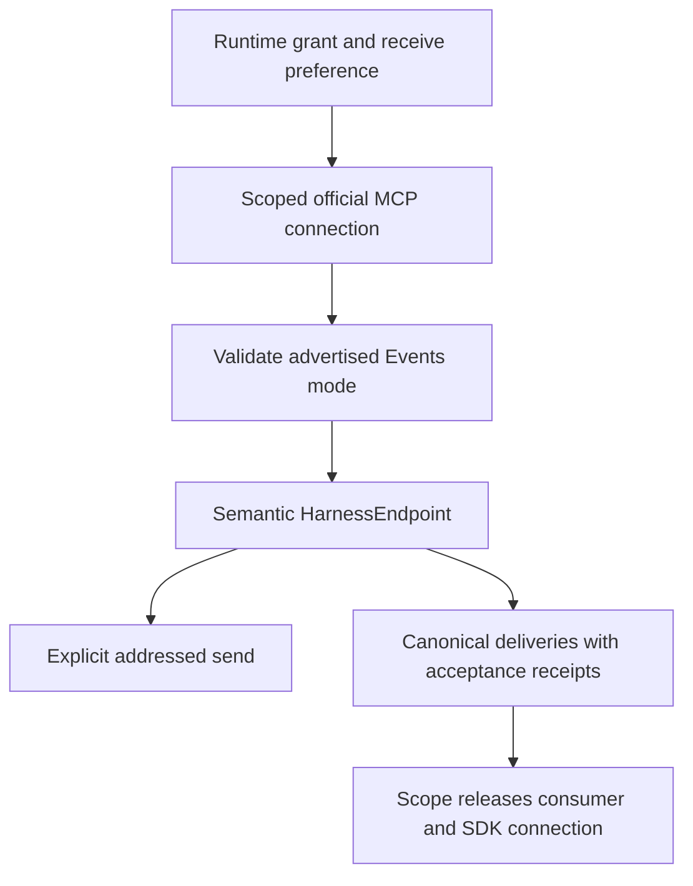

# client/endpoint/harness-endpoint

_`packages/client/src/endpoint/harness-endpoint`_

## Purpose

Scoped MCP implementation of the public semantic HarnessEndpoint.

## Public surface

### [`acquireHarnessEndpoint`](./index.ts#L79)

_Function_

```ts
export function acquireHarnessEndpoint(
  endpoint: URL,
  options: HarnessEndpointOptions = {},
): Effect.Effect<HarnessEndpoint, ConnectError, Scope.Scope>
```

Acquire one real MCP-backed endpoint and its scoped connection.

**Returns:** An endpoint whose resources remain live for the caller's scope.



### [`ConnectError`](./capability.ts#L23)

_Class_

```ts
export class ConnectError extends Data.TaggedError("ConnectError")<{
  readonly reason: ConnectFailure;
}> {
  override get message(): string {
    return `connect failed: ${this.reason}`;
  }
}
```

Acquiring the endpoint connection failed.

### [`HarnessEndpoint`](./capability.ts#L67)

_Interface_

```ts
export interface HarnessEndpoint {
  readonly send: (
    input: SendInput,
    options?: Readonly<{
      failureDelivery?: FailureDelivery;
      idempotencyKey?: string;
    }>,
  ) => Effect.Effect<SendResult, SendError | CollectiveError>;
  readonly messages: Stream.Stream<InboundDelivery, ListenError>;
}
```

Structural runtime capability owned by one scoped endpoint connection.
Every send is one operation or one collective response; the stream yields
inbound items.

A host whose tool returns before the send completes passes
`failureDelivery: "inbound"`: a refused gather, all_gather or response
then completes and its error arrives as an `operationFailed` item on the
stream. A multicast has no operation id, so its failure is always returned.

### [`HarnessEndpointOptions`](./capability.ts#L40)

_Interface_

```ts
export interface HarnessEndpointOptions {
  readonly credential?: Redacted.Redacted;
  /** Defaults to polling with a credential, or native push for a trusted-local host. */
  readonly delivery?:
    | "push"
    | "poll"
    | Readonly<{
        mode: "webhook";
        /** Public HTTPS callback routed to the scoped loopback receiver. */
        url: string;
        /** Deployment's private callback port; no management endpoint is served here. */
        port: number;
        /** Host-local signal after the stream binds and its authenticated subscription is accepted, not after a delivery. */
        onReady?: Effect.Effect<void>;
      }>;
}
```

Explicit remote authentication and native receive mode, without SDK or management authority.

### [`InboundDelivery`](./capability.ts#L32)

_Interface_

```ts
export interface InboundDelivery {
  /** Stable immutable reference for native custody and duplicate-wakeup handling. */
  readonly eventId: string;
  readonly item: InboundItem;
  readonly acknowledge: Effect.Effect<void, DeliveryAcknowledgeError>;
}
```

One inbound item plus its transport-only acknowledgment.

## Files

- `capability.ts`
- `index.ts`
