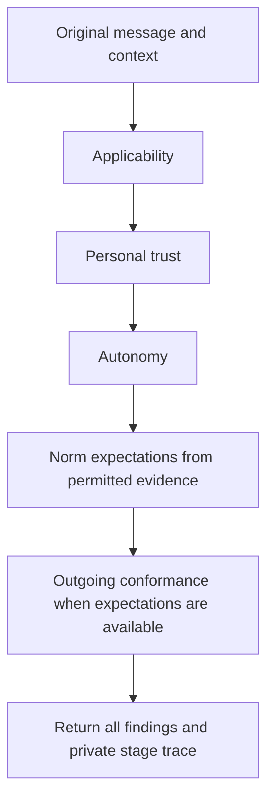
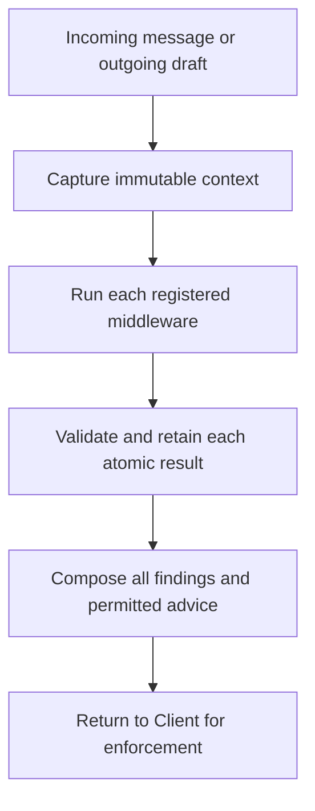

# client/firewall

_`packages/client/src/firewall`_

## Purpose

Personal firewall composition for code and English policies.

## Public surface

### [`CheckedGuidance`](./runtime.ts#L60)

_TypeAlias_

```ts
export type CheckedGuidance = Extract<
  LocalGuidance,
  { readonly checkId: string }
>;
```

The guidance of one checked text: a message, a request, an answer or a question.

### [`CheckInputError`](./values.ts#L241)

_Class_

```ts
export class CheckInputError extends Data.TaggedError("CheckInputError")<{
  readonly reason: "settings" | "registration" | "message" | "context";
}> {}
```

Invalid construction or evidence is a typed failure, never permission.

### [`DecisionProvider`](./values.ts#L366)

_Interface_

```ts
export interface DecisionProvider {
  /** Requested provider configuration, retained even when no response arrives. */
  readonly provenance?: PrivateCheckTrace;
  readonly decide: (
    request: DecisionRequest,
  ) => Effect.Effect<DecisionResponse, DecisionProviderError>;
}
```

Entirely code-based chains have no dependency on this optional capability.

### [`DecisionProviderError`](./values.ts#L350)

_Class_

```ts
export class DecisionProviderError extends Data.TaggedError(
  "DecisionProviderError",
)<{
  readonly reason:
    | "configuration"
    | "transport"
    | "http"
    | "timeout"
    | "invalid-response"
    | "budget"
    | "defect";
  readonly status?: number;
  readonly response?: string;
}> {}
```

The adapter scrubs credentials before retaining optional private diagnostics.

### [`DecisionRequest`](./values.ts#L314)

_Interface_

```ts
export interface DecisionRequest {
  readonly stage: PolicyStage;
  readonly state: string;
  readonly questions: Readonly<
    Record<
      string,
      {
        readonly ruleId: string;
        readonly purpose: "assessment" | "subject";
        readonly subject?: string;
        readonly instructions: string;
        readonly criteria: Readonly<Record<string, string>>;
      }
    >
  >;
}
```

Provider input contains explicit questions and state, never execution authority.

### [`DecisionResponse`](./values.ts#L332)

_Interface_

```ts
export class DecisionResponse extends Schema.Class<DecisionResponse>(
  "DecisionResponse",
)({
  provider: identifier,
  model: identifier,
  answers: Schema.Record({
    key: identifier,
    value: Schema.Struct({
      choice: identifier,
      probabilities: Schema.Record({ key: identifier, value: probability }),
      confidence: Schema.optional(probability),
    }),
  }),
  usage: Schema.Record({ key: identifier, value: Schema.NonNegativeInt }),
  raw: Schema.String,
}) {}
```

Raw distributions and provider confidence survive routing unchanged.

### [`EnglishPolicySettings`](./values.ts#L297)

_Interface_

```ts
export class EnglishPolicySettings extends Schema.Class<EnglishPolicySettings>(
  "EnglishPolicySettings",
)({
  minimumProbability: Schema.Number.pipe(Schema.between(0.5, 1)),
  maximumRequestBytes: Schema.Positive.pipe(Schema.int()),
  timeoutMilliseconds: Schema.Positive.pipe(Schema.int()),
}) {}
```

Bytes bound allocation, not tokenizer capacity; probability is a routing setting.

### [`EnglishRule`](./values.ts#L131)

_Interface_

```ts
export class EnglishRule extends Schema.Class<EnglishRule>("EnglishRule")({
  ...RuleDescription.fields,
  text: Schema.NonEmptyString,
}) {}
```

Text is interpreted by the provider; it is never compiled into executable code.

### [`Firewall`](./values.ts#L285)

_Interface_

```ts
export interface Firewall {
  readonly checkIncoming: (
    message: Message,
    context: MessageContext,
  ) => Effect.Effect<IncomingCheck, CheckInputError>;
  readonly checkOutgoing: (
    draft: Message,
    context: MessageContext,
  ) => Effect.Effect<OutgoingCheck, CheckInputError>;
}
```

Checking returns data; Client separately owns fresh, atomic send/delivery admission.

### [`FirewallPolicyError`](./values.ts#L531)

_Class_

```ts
export class FirewallPolicyError extends Data.TaggedError(
  "FirewallPolicyError",
)<{
  readonly reason:
    | "not-configured"
    | "invalid-rule"
    | "fixed-rule"
    | "build-failed"
    | "persistence-failed";
}> {}
```

A failed edit never replaces the active installation or retained editable document.

### [`FirewallSendError`](./runtime.ts#L109)

_Class_

```ts
export class FirewallSendError extends Data.TaggedError("FirewallSendError")<
  typeof firewallRefusalSchema.Type
> {
  override get message(): string {
    const feedback = this.feedback
      .map((item) => `Next action: ${item.nextAction}. ${item.text}`)
      .join(" ");
    const description = `send withheld (check ${this.checkId}): ${refusalText[this.refusal]}.`;
    return feedback.length === 0 ? description : `${description} ${feedback}`;
  }
}
```

A refusal is returned only before an application invocation creates any intent.
Its opaque check reference survives hosts that retain only the error message.

### [`FirewallSettings`](./values.ts#L231)

_Interface_

```ts
export class FirewallSettings extends Schema.Class<FirewallSettings>(
  "FirewallSettings",
)({
  timeoutMilliseconds: Schema.Positive.pipe(Schema.int()),
  middlewareTimeoutMilliseconds: Schema.Positive.pipe(Schema.int()),
  maximumInputBytes: Schema.Positive.pipe(Schema.int()),
  maximumResultBytes: Schema.Positive.pipe(Schema.int()),
}) {}
```

Sequential execution is bounded per entry and across the whole attempt.

### [`LocalGuidance`](./runtime.ts#L57)

_TypeAlias_

```ts
export type LocalGuidance = typeof localGuidanceSchema.Type;
```

Local advice accompanies the envelope and never changes a certified item.

### [`makeEnglishPolicy`](./english.ts#L237)

_Variable_

```ts
export const makeEnglishPolicy = Effect.fn("makeEnglishPolicy")(
  function* (options: {
    readonly id: string;
    readonly rules: readonly EnglishRule[];
    readonly provider: DecisionProvider;
    readonly settings: unknown;
  }): Effect.fn.Return<MessageMiddleware, CheckInputError> {
    const settings = yield* decodeFrozen(
      EnglishPolicySettings,
      options.settings,
    ).pipe(
      Effect.catchTag("ParseError", () =>
        Effect.fail(new CheckInputError({ reason: "settings" })),
      ),
    );
    const { id, rules } = yield* decodeFrozen(
      Schema.Struct({
        id: Schema.NonEmptyTrimmedString,
        rules: Schema.NonEmptyArray(EnglishRule),
      }),
      { id: options.id, rules: options.rules },
    ).pipe(
      Effect.catchTag("ParseError", () =>
        Effect.fail(new CheckInputError({ reason: "registration" })),
      ),
    );
    if (new Set(rules.map((rule) => rule.id)).size !== rules.length) {
      return yield* new CheckInputError({ reason: "registration" });
    }
    const descriptions = yield* ruleDescriptions(rules);
    const revision = englishRevision(rules, settings);
    const provider = Object.freeze({
      decide: options.provider.decide.bind(options.provider),
    });
    return Object.freeze({
      id,
      revision,
      rules: descriptions,
      provenance: englishProvenance(rules, settings, options.provider),
      check: (input: MiddlewareInput) =>
        checkEnglish(input, { rules, revision }, provider, settings),
    });
  },
)
```

Freezes English documents and provider settings for repeated checks in either
direction. Question semantics and documents determine the recorded revision.



### [`makeFirewall`](./index.ts#L64)

_Variable_

```ts
export const makeFirewall = Effect.fn("makeFirewall")(function* (options: {
  readonly incoming: readonly MessageMiddleware[];
  readonly outgoing: readonly MessageMiddleware[];
  readonly settings: unknown;
}): Effect.fn.Return<Firewall, CheckInputError> {
  const settings = yield* decodeFrozen(FirewallSettings, options.settings).pipe(
    Effect.catchTag("ParseError", () =>
      Effect.fail(new CheckInputError({ reason: "settings" })),
    ),
  );
  const incoming = yield* makeChain(options.incoming, settings);
  const outgoing = yield* makeChain(options.outgoing, settings);
  return Object.freeze({
    checkIncoming: (message: Message, context: MessageContext) =>
      incoming({ direction: "incoming", message }, context).pipe(
        Effect.flatMap((result) =>
          result.judgment === "revise"
            ? Effect.fail(new CheckInputError({ reason: "message" }))
            : Effect.succeed({ ...result, judgment: result.judgment }),
        ),
      ),
    checkOutgoing: (message: Message, context: MessageContext) =>
      outgoing({ direction: "outgoing", message }, context),
  });
})
```

Runs every installed check in order within the budget. Refusals accumulate;
only Client can apply the result to an exact candidate with fresh evidence.
Cancellation propagates, so an interrupted check never returns permission.



### [`makeJevDecisionProvider`](./jev.ts#L169)

_Function_

```ts
export function makeJevDecisionProvider(options: {
  readonly apiKey: Redacted.Redacted;
  readonly model: string;
}): DecisionProvider
```

Uses the fixed TypeSafe origin and an explicitly pinned model. No retry,
environment lookup or credential serialization occurs here. The evaluator
owns timeouts; the Effect is interruptible through response-body consumption.

### [`Message`](./values.ts#L38)

_Interface_

```ts
export class Message extends Schema.Class<Message>("Message")({
  id: identifier,
  sender: identifier,
  recipients: Schema.NonEmptyArray(identifier),
  text: Schema.String,
  operation: Schema.optional(messageOperation),
}) {}
```

Attribution is supplied by Client, never inferred from names in the body.
`operation` is absent for a plain message.

### [`MessageContext`](./values.ts#L74)

_Interface_

```ts
export class MessageContext extends Schema.Class<MessageContext>(
  "MessageContext",
)({
  agentId: identifier,
  principal: identifier,
  participants: Schema.Array(
    Schema.Struct({
      agentId: identifier,
      principal: identifier,
    }),
  ),
  history: Schema.Array(HistoryEntry),
  /** Older certified records outside the configured window are not an evidence gap. */
  earlierHistoryOmitted: Schema.optional(Schema.Boolean),
  /** Epoch milliseconds when Client captured the context, so a deadline can be judged and a check replayed. */
  now: Schema.optional(Schema.Int.pipe(Schema.nonNegative())),
  facts: Schema.Array(
    Schema.Struct({
      id: identifier,
      source: identifier,
      text: Schema.NonEmptyString,
      visibility,
    }),
  ),
  gaps: Schema.Array(Schema.NonEmptyString),
  authorization: Schema.Union(
    Schema.Struct({ kind: Schema.Literal("absent") }),
    approval,
  ),
}) {}
```

Trusted composition supplies authorized earlier evidence and candidate-specific
approval. Agent identity and principal identity have different meanings.
The first live composition supplies absent approval.

### [`MessageMiddleware`](./values.ts#L219)

_Interface_

```ts
export interface MessageMiddleware {
  readonly id: string;
  readonly revision: string;
  readonly rules: readonly RuleDescription[];
  /** Descriptive audit data declared by trusted composition, never authority. */
  readonly provenance?: PrivateCheckTrace;
  readonly check: (
    input: MiddlewareInput,
  ) => Effect.Effect<MiddlewareResult, MiddlewareError>;
}
```

Code and English policies have the same contract. Registered code is trusted;
it receives no messaging/store capability and must not retain conversation
state or perform messaging side effects.

### [`MiddlewareError`](./values.ts#L185)

_Class_

```ts
export class MiddlewareError extends Data.TaggedError("MiddlewareError")<{
  readonly reason:
    | "unavailable"
    | "timeout"
    | "invalid-result"
    | "budget"
    | "defect";
}> {}
```

Operational failures carry closed reasons, never arbitrary exception text.

### [`MiddlewareInput`](./values.ts#L206)

_Interface_

```ts
export class MiddlewareInput extends Schema.Class<MiddlewareInput>(
  "MiddlewareInput",
)({
  event: messageEvent,
  context: MessageContext,
  previous: Schema.Array(MiddlewareObservation),
}) {}
```

Each invocation gets immutable evidence and previously validated observations.

### [`MiddlewareResult`](./values.ts#L176)

_Interface_

```ts
export class MiddlewareResult extends Schema.Class<MiddlewareResult>(
  "MiddlewareResult",
)({
  findings: Schema.Array(policyFinding),
  expectations: Schema.Array(NormExpectation),
  trace: Schema.optional(PrivateCheckTrace),
}) {}
```

A result is atomic: interrupted middleware has no returned partial findings.

### [`RuleDescription`](./values.ts#L115)

_Interface_

```ts
export class RuleDescription extends Schema.Class<RuleDescription>(
  "RuleDescription",
)({
  id: identifier,
  kind: Schema.Literal("safety", "autonomy", "norm"),
  source: Schema.optional(identifier),
  guidance: Schema.optional(Schema.NonEmptyString),
  feedback: Schema.optional(
    Schema.Struct({
      text: Schema.NonEmptyString,
      nextAction,
    }),
  ),
}) {}
```

Runtime advice can only select templates registered by trusted composition.

## Files

- `english.ts`
- `index.ts`
- `jev.ts`
- `runtime.ts`
- `values.ts`
