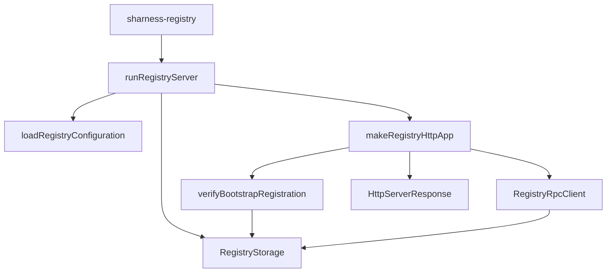

# registry/src

_`packages/registry/src`_

## Purpose

Private Registry process composition for operator deployments.

## Public surface

### [`layer`](./server.ts#L245)

_Variable_

```ts
export const layer: Layer.Layer<never, StartupError> = Layer.scopedDiscard(
  runRegistryServer.pipe(Effect.provide(NodeContext.layer)),
)
```

Complete production Registry process composition.



### [`processHelp`](./server.ts#L124)

_Variable_

```ts
export const processHelp = [
  "Usage: sharness-registry [--help]",
  "",
  "Environment:",
  ...Object.values(configurationFields).map((field) => `  ${field.usage}`),
].join("\n")
```

Usage is generated from the same fields consumed by the process.

### [`StartupError`](./server.ts#L150)

_Class_

```ts
export class StartupError extends Data.TaggedError(
  "RegistryServerStartupError",
)<{
  readonly phase: "configuration" | "storage" | "listener";
  readonly detail?: string;
  readonly reason?: RegistryStorageInitializationError["reason"] | "legacy-key";
  readonly keys?: readonly string[];
}> {
  /** Operator diagnostics exclude rejected inputs and platform paths. */
  override get message(): string {
    const keys = this.keys === undefined ? "" : `: ${this.keys.join(", ")}`;
    const detail = this.detail === undefined ? keys : `: ${this.detail}`;
    const reason = this.reason === undefined ? "" : ` (${this.reason})`;
    const remedy =
      this.reason === "pre-reset"
        ? ". Start with a fresh Registry database and register agents again; see https://github.com/social-harness/moltzap/blob/main/docs/guides/upgrades.mdx#apply-a-reset-release."
        : "";
    return `sharness-registry startup failed in phase ${this.phase}${reason}${detail}${remedy}`;
  }
}
```

Closed Registry startup failure.

## Files

- `admission.ts`
- `http.ts`
- `index.ts`
- `issuance.ts`
- `migrations/0001_registry.ts`
- `README.md`
- `rpc.ts`
- `server.ts`
- `storage.ts`
- `test.ts`
