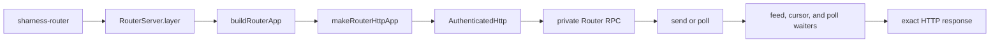

# router/src

_`packages/router/src`_

## Purpose

Public Router contracts: opaque SignedMessages addressed to
explicit AgentIds, send results, and bounded endpoint-wide
PollCursors. Router carries no ConversationId, membership,
transaction, persistence, replay, or recovery semantics; those
belong to the endpoint Harness in `@moltzap/client`.

## Public surface

### [`PollCursor (type)`](./router/contract.ts#L102)

_TypeAlias_

```ts
export type PollCursor = typeof PollCursor.Type;
```

Validated opaque Router poll continuation.

### [`PollCursor (value)`](./router/contract.ts#L90)

_Variable_

```ts
export const PollCursor = Schema.String.pipe(
  Schema.filter(hasCanonicalCursorShape, {
    identifier: "PollCursor",
    description: "Canonical opaque Router poll continuation",
  }),
  Schema.brand("PollCursor"),
  Schema.annotations({
    identifier: "PollCursor",
    description: "Canonical opaque Router poll continuation",
  }),
)
```

Opaque, authenticated continuation for one caller and Router instance.

### [`Router`](./router.ts#L87)

_Class_

```ts
export class Router extends Context.Tag("@moltzap/router/Router")<
  Router,
  RouterClientService
>() {
  static readonly send: (input: {
    readonly request: RouterSendRequest;
    readonly callerAgentId: AgentId;
    readonly signingAuthority: AgentSigningAuthority;
  }) => Effect.Effect<RouterSendResult, RouterClientError, Router> =
    Effect.serviceFunctionEffect(Router, (service) => service.send);

  static readonly poll: (input: {
    readonly request: RouterPollRequest;
    readonly callerAgentId: AgentId;
    readonly signingAuthority: AgentSigningAuthority;
  }) => Effect.Effect<RouterPollResult, RouterClientError, Router> =
    Effect.serviceFunctionEffect(Router, (service) => service.poll);

  static readonly layer = (input: {
    readonly origin: URL;
    readonly sendTimeout: Duration.Duration;
    readonly pollTimeout: Duration.Duration;
  }): Layer.Layer<Router, never, HttpClient.HttpClient> =>
    Layer.effect(Router, makeRouterClient(input));
}
```

Opaque message acceptance and endpoint-wide bounded polling.

### [`RouterConnectionError`](./router/contract.ts#L223)

_Class_

```ts
export class RouterConnectionError extends Data.TaggedError(
  "RouterConnectionError",
) {}
```

The Router connection could not be established or used.

### [`RouterInstanceId (type)`](./router/contract.ts#L78)

_TypeAlias_

```ts
export type RouterInstanceId = typeof RouterInstanceId.Type;
```

Validated Router process identity.

### [`RouterInstanceId (value)`](./router/contract.ts#L72)

_Variable_

```ts
export const RouterInstanceId = canonicalValue(
  "RouterInstanceId",
  "rti_",
  INSTANCE_BYTE_LENGTH,
)
```

Identifies one volatile Router process instance.

### [`RouterInvalidResponseError`](./router/contract.ts#L233)

_Class_

```ts
export class RouterInvalidResponseError extends Data.TaggedError(
  "RouterInvalidResponseError",
) {}
```

A Router response did not match the selected operation contract.

### [`RouterPollRequest (type)`](./router/contract.ts#L188)

_TypeAlias_

```ts
export type RouterPollRequest = typeof pollRequest.Type;
```

One authenticated endpoint-wide poll request with an optional `pollCursor`.

### [`RouterPollRequest (value)`](./router/contract.ts#L183)

_Variable_

```ts
export const RouterPollRequest: Schema.Schema<
  RouterPollRequest,
  typeof pollRequest.Encoded
> = pollRequest
```

Exact Schema for one endpoint-wide poll request.

### [`RouterPollResult (type)`](./router/contract.ts#L218)

_TypeAlias_

```ts
export type RouterPollResult = typeof pollResult.Type;
```

Closed poll outcome: `batch` carries `routerInstanceId`, `signedMessages`,
and `pollCursor`; `feed_gap` carries `routerInstanceId`.
`cursor_invalid` carries only its `kind` discriminator.

### [`RouterPollResult (value)`](./router/contract.ts#L209)

_Variable_

```ts
export const RouterPollResult: Schema.Schema<
  RouterPollResult,
  typeof pollResult.Encoded
> = pollResult
```

Exact Schema for every closed poll outcome.

### [`RouterRequestTimeoutError`](./router/contract.ts#L228)

_Class_

```ts
export class RouterRequestTimeoutError extends Data.TaggedError(
  "RouterRequestTimeoutError",
) {}
```

The configured complete Router call deadline expired.

### [`RouterSendRequest (type)`](./router/contract.ts#L136)

_TypeAlias_

```ts
export type RouterSendRequest = typeof sendRequest.Type;
```

One authenticated request to accept or recover an opaque message, carrying
`expectedRouterInstanceId`, `mode` (`initial` or `retry`), and `signedMessage`.

### [`RouterSendRequest (value)`](./router/contract.ts#L128)

_Variable_

```ts
export const RouterSendRequest: Schema.Schema<
  RouterSendRequest,
  typeof sendRequest.Encoded
> = sendRequest
```

Exact Schema for one send request.

### [`RouterSendResult (type)`](./router/contract.ts#L176)

_TypeAlias_

```ts
export type RouterSendResult = typeof sendResult.Type;
```

Closed send outcome: `accepted` carries `routerInstanceId` and
`signedMessageDigest`; `router_restarted` carries `routerInstanceId`.
`message_invalid`, `idempotency_conflict`, and `retry_identity_unknown`
carry only their `kind` discriminator.

### [`RouterSendResult (value)`](./router/contract.ts#L166)

_Variable_

```ts
export const RouterSendResult: Schema.Schema<
  RouterSendResult,
  typeof sendResult.Encoded
> = sendResult
```

Exact Schema for every closed send outcome.

### [`SignedMessageDigest (type)`](./router/contract.ts#L87)

_TypeAlias_

```ts
export type SignedMessageDigest = typeof SignedMessageDigest.Type;
```

Validated SignedMessage equality receipt.

### [`SignedMessageDigest (value)`](./router/contract.ts#L81)

_Variable_

```ts
export const SignedMessageDigest = canonicalValue(
  "SignedMessageDigest",
  "smd_",
  DIGEST_BYTE_LENGTH,
)
```

Equality receipt for one complete retained SignedMessage.

## Package subpaths

### `@moltzap/router/server`

#### [`RouterServer`](./server.ts#L33)

_Namespace_

#### [`RouterServer.StartupError`](./server.ts#L38)

_Class_

```ts
  export class StartupError extends Data.TaggedError(
    "RouterServerStartupError",
  )<{
    readonly phase: "configuration" | "listener";
    readonly detail?: string;
    readonly reason?: "legacy-key";
    readonly keys?: readonly string[];
  }> {
    /** Rejected environment values never enter the operator message. */
    override get message(): string {
      const keys = this.keys === undefined ? "" : `: ${this.keys.join(", ")}`;
      const reason =
        this.reason === undefined ? "" : ` (${this.reason}${keys})`;
      const detail = this.detail === undefined ? reason : `: ${this.detail}`;
      return `sharness-router startup failed in phase ${this.phase}${detail}`;
    }
  }
```

Closed Router startup phase.

#### [`RouterServer.help`](./server.ts#L35)

_Variable_

```ts
  export const help = processHelp
```

Usage text listing the Router process's environment variables.

#### [`RouterServer.layer`](./server.ts#L90)

_Variable_

```ts
  export const layer: Layer.Layer<never, StartupError> =
    Layer.scopedDiscard(runRouterServer)
```

Complete production Router process composition.



## Files

- `index.ts`
- `router.ts`
- `router/contract.ts`
- `router/feed.ts`
- `router/http.ts`
- `router/poll-cursor.ts`
- `router/poll-waiters.ts`
- `router/poll.ts`
- `router/README.md`
- `router/rpc.ts`
- `router/send.ts`
- `server.ts`
